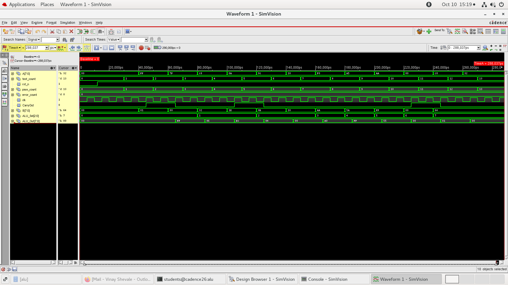
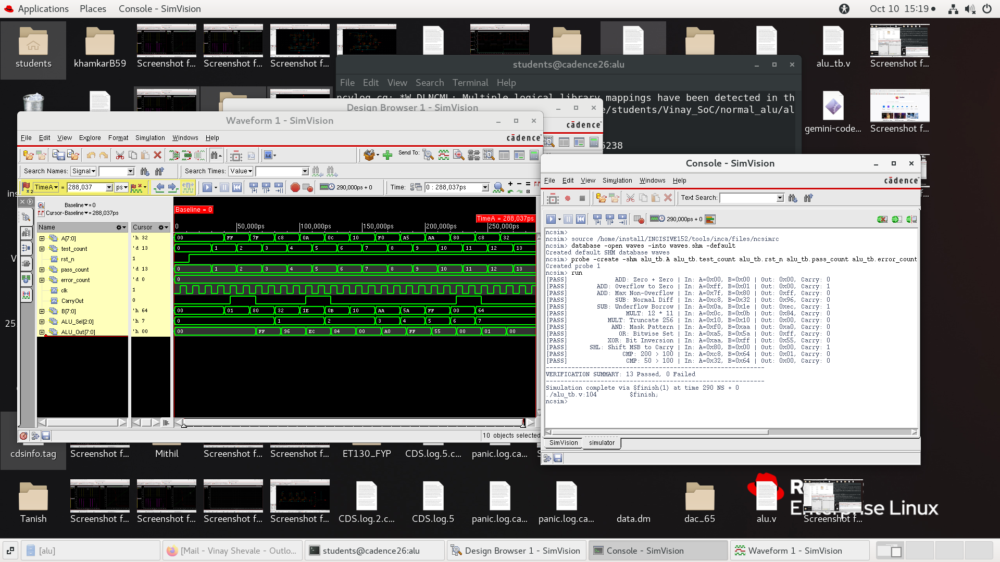
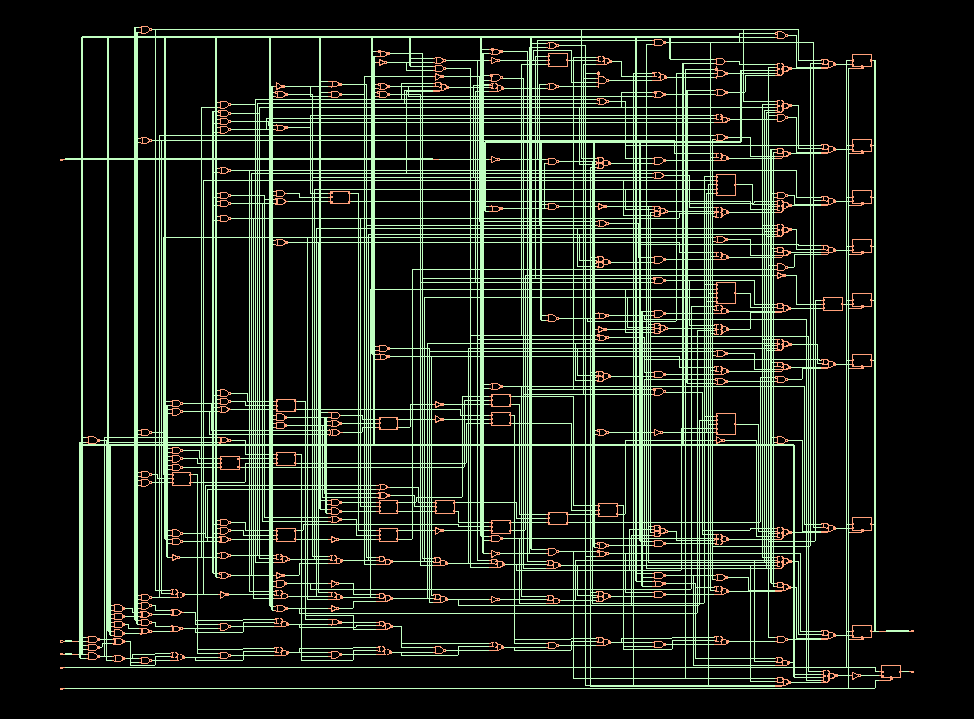
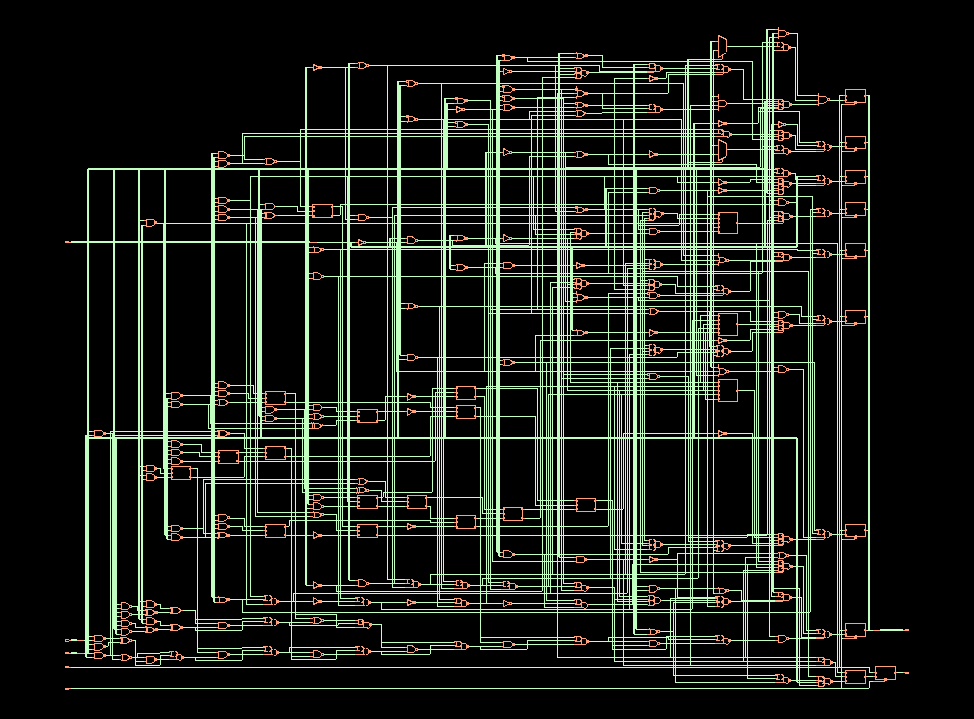

# Exact and Approximate 8-bit ALU

This repository compares two synchronous 8-bit ALUs:

- **`alu`** — exact arithmetic.
- **`approx_alu`** — the same operations, but with approximate 8-bit addition and subtraction.

Both designs have the same interface and eight operations. The checked-in Genus reports show that the approximate version maps to fewer cells, lower reported area, and lower estimated power, but has a slightly longer reported worst data path. These are synthesis results, not placed-and-routed measurements.

## Design comparison

| `ALU_Sel` | Operation | `alu` | `approx_alu` |
|---|---|---|---|
| `000` | Add | Exact 8-bit sum; `CarryOut` is the carry out | Bits `[7:2]` add exactly; bits `[1:0]` are `A[1:0] \| B[1:0]`. No carry propagates from the low two bits into the upper addition. `CarryOut` is the upper-six-bit carry. |
| `001` | Subtract | Exact 8-bit difference; `CarryOut` indicates unsigned borrow | Bits `[7:2]` subtract exactly; bits `[1:0]` are `A[1:0] ^ B[1:0]`. No borrow propagates from the low two bits into the upper subtraction. `CarryOut` is the upper-six-bit borrow. |
| `010` | Multiply | Low eight bits of `A * B` | Same as `alu` |
| `011` | AND | `A & B` | Same as `alu` |
| `100` | OR | `A \| B` | Same as `alu` |
| `101` | XOR | `A ^ B` | Same as `alu` |
| `110` | Shift left | `{A[6:0], 1'b0}`; `CarryOut = A[7]` | Same as `alu` |
| `111` | Greater-than comparison | `ALU_Out = 1` when unsigned `A > B`, otherwise `0` | Same as `alu` |

Both modules register `ALU_Out` and `CarryOut` on the rising edge of `clk`, and clear them with an asynchronous active-low `rst_n`.

The approximation only affects the low two bits of addition and subtraction and their connection to the upper arithmetic. For example, `3 + 1` produces `3` in `approx_alu` rather than the exact result `4`; `4 - 1` produces `5` rather than `3`. The multiplication, logic, shift, and comparison operations remain exact and match the baseline.

## Synthesis comparison

The values below are transcribed from the checked-in Genus [cell-area](synthesis/normal_alu/reports/alu_cell.rep), [power](synthesis/normal_alu/reports/alu_power.rep), and [timing](synthesis/normal_alu/reports/alu_timing.rep) reports and the corresponding [`approx_alu` reports](synthesis/approx_alu/reports/). The same `constraints/alu.sdc` is read by both synthesis scripts. It specifies a 10 ns clock, 0.1 ns clock transitions, 0.01 ns clock uncertainty, and 1 ns input/output delays.

| Metric | `alu` | `approx_alu` | Approximate vs. exact |
|---|---:|---:|---:|
| Standard-cell count | 240 | 218 | −22 (−9.17%) |
| Total cell area | 1382.099 | 1302.625 | −79.474 (−5.75%) |
| Leakage power | 5.73318 µW | 5.40602 µW | −5.71% |
| Internal power | 46.2236 µW | 43.8054 µW | −5.23% |
| Switching power | 15.2620 µW | 14.0491 µW | −7.95% |
| Total power | 67.2187 µW | 63.2606 µW | −5.89% |
| Worst reported data-path delay | 2172 ps | 2338 ps | +166 ps (+7.64%) |
| Worst setup slack | 6747 ps | 6581 ps | −166 ps |

**How to read these results:** both timing reports mark the worst setup path as met. In both designs, that reported path traverses the multiplier and ends at `ALU_Out_reg[6]/D`; it is not an adder/subtractor path. The approximate version has lower reported area and power, but the report does **not** show an improvement in the worst data-path delay or slack. The cell-area report does not specify an area unit. The power reports identify a single tool frame (`/stim#0/frame#0`); no VCD or SAIF activity file is included, so treat power as a Genus estimate rather than a measurement of a defined workload.

The reports were generated by Cadence Genus 21.14-s082_1 using the `slow` library and `slow (balanced_tree)` operating conditions. The library itself is not included; the synthesis scripts refer to a machine-specific library path.

The other archived Genus captures are available as [timing report 1](results/Genus_Timing_report1.png), [timing report 2](results/Genus_Timing_report2.png), [power details](results/Genus_Power_Details.png), [datapath area](results/Genus_Report_DataPath.png), and [gate-level schematic](results/Genus_Gate_Level_Schematic.png). These screenshots document the baseline `alu` run; the `.rep` files are the source for the numeric comparison above.

## Verification evidence

The repository contains a directed testbench for each RTL design. The baseline simulation screenshot shows **13 passed, 0 failed**. The approximate testbench contains 37 directed operation tests and an asynchronous-reset check, but no run log or result screenshot for that testbench is included, so its pass/fail result is **not verified here**.

The waveform below is the archived SimVision capture of the **baseline `alu` testbench only**. It is an image, not a waveform database; there is no corresponding waveform file for the approximate design.



The accompanying console capture shows the baseline test summary:



## Genus schematics

These are the archived synthesized schematics. They illustrate the mapped logic, not a physical layout or a place-and-route result.

| Exact `alu` | Approximate `approx_alu` |
|---|---|
|  |  |

## Repository contents

| Path | Contents |
|---|---|
| `rtl/alu.v`, `rtl/approx_alu.v` | Exact and approximate RTL |
| `tb/alu_tb.v`, `tb/approx_alu_tb.v` | Directed Verilog testbenches |
| `constraints/alu.sdc` | Input timing constraints used by both synthesis scripts |
| `synthesis/normal_alu/` | Baseline Genus script, log, reports, netlist, exported SDC, and SDF |
| `synthesis/approx_alu/` | Approximate Genus script, log, reports, netlist, exported SDC, and SDF |
| `results/` | Simulation screenshots, Genus report captures, and synthesized schematics |

## Reproducing the flows

The source archive does not include Cadence tools or the `slow.lib` standard-cell library. The synthesis scripts also use relative RTL and SDC filenames and end with `gui_show`; run each script from a working directory containing the corresponding RTL file and a copy of `alu.sdc`, with the library path in `rc_script.tcl` updated for your environment.

To run the testbenches with Cadence irun, use the matching RTL and testbench files:

```bash
irun rtl/alu.v tb/alu_tb.v -access +rwc
irun rtl/approx_alu.v tb/approx_alu_tb.v -access +rwc
```

Only the baseline run is represented by archived simulation evidence. Running either command locally requires a compatible simulator; running the synthesis flow additionally requires Genus and the referenced standard-cell library.
